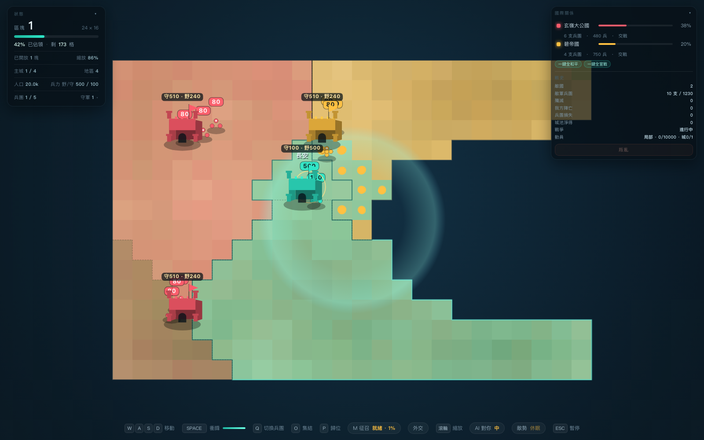

<div align="center">

# 無盡領土 · Endless Territory

**A single-file HTML real-time strategy game · 47 versions, all open source**

**English** · [中文](README.md)

[▶ Play the latest build](https://sgxdvx123321-svg.github.io/endless-territory/versions/territory-v48.html) · [🗂 Version gallery](https://sgxdvx123321-svg.github.io/endless-territory/) · [MIT](LICENSE)

</div>

---

## Opening: the entire dev line, handed to the community

This is a **small HTML game I built with an AI together, out of frustration while playing _WorldBox_ and _Fantasy Map Simulator_**. One file, no build step, no framework, no `npm install` — double-click and play.

So the whole iteration line (**v2 → v48, 47 playable snapshots**) is being dumped into the community as-is: **download it, play it, change it, take it — all fine.**
No license traps, no "for learning purposes only". If a rule annoys you, change it; PRs and forks are welcome.

I also hope more people will chip in to make the game deeper — one more unit type, a different economy, a new AI, a completely rebuilt map generator, all count.

And I'm **genuinely asking for help**:

- **Clean up the code.** It is 7,000 lines in a single file: `<style>`, `<canvas>` and game logic all in one place. Splitting it into modules (`src/world.js`, `src/army.js`, `src/render.js`…) or adding TypeScript types would be very welcome.
- **Build it outside the browser.** Desktop (Electron / Tauri), mobile apps, Unity / Godot / PixiJS remakes, even a native indie game — the art and the numbers are all in the source.
- **Turn the version pile into something maintainable.** The 47 snapshots are just sitting side by side; if you can tell which branch is worth keeping and which part should be cut, please do.

> The project has no commercial purpose — it is just an experiment in how far "one person + an AI, messing around" can go. Have fun.



---

## What kind of game is this

You don't control a hero — you control **an army**. Ground you walk over becomes your territory.

- **Claiming land**: every cell your army walks over instantly turns your color; enemies have to walk over it to take it back.
- **Sieges**: stand next to an enemy capital for a few seconds to take it; if the rest of the region is eaten, the capital surrenders by itself (since v32 that only speeds up the siege instead of auto-capturing).
- **Armies**: population grows every 30 seconds, and every 10,000 people form one army. When an army is wiped out, the next one takes over.
- **World**: 288×144 cells, **63 conquerable zones**, **306 capitals**, you + 12 AI factions (up to 50 cities each).
- **Diplomacy**: peace / war / alliance; the AI factions fight, ally and rebel among themselves too.
- **Two opening modes**: `progressive` (unlock and fight zone by zone) or `full continent` (the whole map is open from turn one — pure grand strategy).

---

## Play now

| How | Link |
|---|---|
| ▶ **Play the latest v48 online** | <https://sgxdvx123321-svg.github.io/endless-territory/versions/territory-v48.html> |
| 🗂 **Version gallery (online)** | <https://sgxdvx123321-svg.github.io/endless-territory/> |
| Raw file | [`versions/territory-v48.html`](versions/territory-v48.html) |
| Download every version | `git clone`, see below |

> The online build is hosted on GitHub Pages and also runs in mobile browsers; for offline play, just download the single file.

Get all versions:

```bash
git clone https://github.com/sgxdvx123321-svg/endless-territory.git
cd endless-territory
open versions/territory-v48.html   # macOS; on Windows just double-click
```

Add `?seed=12345` to reproduce the same world; `?auto` skips the main menu and starts a game straight away (handy for screenshots and testing).

---

## Controls

| Key | Action |
|---|---|
| `W` `A` `S` `D` | Move the army |
| `Space` | Charge (speed boost) |
| `Q` / `E` | Switch the army you control |
| `+` / `-` | Reinforce / zoom |
| `O` | Rally order (nearest N armies / nationwide) |
| `P` | Return home (nearest own capital) |
| `M` | Emergency conscription (population → troops) |
| `N` | Pull garrison troops out |
| `F` | Center the camera on the current army |
| `1`–`4` | Combined-legion formations |
| `Esc` | Pause / settings (difficulty, conscription rate, save & load) |

Mouse: left-click one of your units to take control there; **right-click** adds a whole unit to a combined legion, right-drag box-selects; scroll to zoom, left-drag to pan the camera.

---

## Version list

Ten eras, 47 playable snapshots. The full evolution is in [`docs/VERSIONS.md`](docs/VERSIONS.md) (Chinese), and per-version details — including headless verification data — are in [`docs/CHANGELOG.md`](docs/CHANGELOG.md) (Chinese).

<details open>
<summary><b>I · Foundations v2 – v5</b>: how the map came to be</summary>

| Version | Key change |
|---|---|
| v2 | Baseline. Zone-based world, a new zone unlocks only after the open ones are eaten, zoomable camera |
| v3 | Regions + capitals: stand in a city for 5 seconds to capture it, regions surrender when eaten |
| v4 | One whole continent, fog revealed in concentric rings |
| v5 | Continent mask + flood fill, fixing the fatal "stranded island" lock-up |

</details>

<details>
<summary><b>II · Gameplay v6 – v9</b>: texture and difficulty</summary>

| Version | Key change |
|---|---|
| v6 | Terrain (grass / snow / desert / jungle), population growth, armies, supply-based campaigns |
| v7 | The army becomes the piece; the hero body is removed |
| v8 | Full defensive advantage (three damage tiers, damage reduction, militia) |
| v9 | Tighter garrison siphoning; enemy advantage pushed to zone 11, with an ESC toggle |

</details>

<details>
<summary><b>III · Command v10 – v13</b>: see it, order it</summary>

| Version | Key change |
|---|---|
| v10 | Total troop display, army list, `O` rally order |
| v11 | `M` emergency conscription (1% population → troops) |
| v12 | Conscription rate adjustable in ESC (1–20%) |
| v13 | Rally can target "nearest N / nationwide", `P` return home |

</details>

<details>
<summary><b>IV · Empire v14 – v17</b>: wars get big</summary>

| Version | Key change |
|---|---|
| v14 | Soft push-out between armies, a second continent, diplomacy, 3 save slots |
| v15 | Push-out replaced by movement blocking, BFS pathfinding, stronghold economy, city naming, autosave |
| v16 | Automatic army cap (`max(5, city count)`) |
| v17 | `N` really spreads the troops, enemy alliances (aimed at the player) |

</details>

<details>
<summary><b>V · AI v18 – v20</b>: how armies think, how wars are recorded</summary>

| Version | Key change |
|---|---|
| v18 | Target assignment (recomputed every second, max 3 armies per target), three priority tiers, hit locally first |
| v19 | War history panel (kills / losses / army losses / net cities) |
| v20 | Rebellion: a connected region breaks off into a new faction, and you can pick a side |

</details>

<details>
<summary><b>VI · Continent v21 – v25</b>: one world, many nations</summary>

| Version | Key change |
|---|---|
| v21 | Second continent removed, 63 zones, opening modes, 12 factions, 16 colors |
| v22 | Fixed the single-nation page, nearest-army rule |
| v23 | Full-continent starts at peace, one-click peace / war for everyone |
| v24 | Field armies and garrisons split into different stats |
| v25 | Enemy growth scaled to the player's troop count |

</details>

<details>
<summary><b>VII · Military system v26 – v33</b>: units, formations, rules converge</summary>

| Version | Key change |
|---|---|
| v26 | Garrisons become numbers inside cities; besieging field armies spawn outside |
| v27 | Combined legions v1 (four formations) |
| v28 | Multiple combined legions, pass-through inside a legion |
| v29 | Fixed the ESC "army count display" toggle not responding |
| v30 | Troop counts gathered above the leader, save slots 3 → 10 |
| v31 | Strays rejoin after 3 seconds, rally excludes your own legion |
| v32 | Eaten-up regions no longer auto-surrender, enemy three-legion system, splitting |
| v33 | Enemy garrisons convert 10% to field armies every 30 seconds |

</details>

<details>
<summary><b>VIII · Consolidation v34 – v38</b>: controls, rules, war history</summary>

| Version | Key change |
|---|---|
| v34 | Drag formation, enemy population converts to garrisons, enemy aggression raised |
| v35 | Three-empty cities capturable in 3 seconds, auto-garrison after 15 seconds |
| v36 | Combined legions attack first, besieged cities cannot conscript |
| v37 | Combined legion formation moved to right-click; left-click back to select & rename |
| v38 | Diplomacy also in zone mode, list of dead factions |

</details>

<details>
<summary><b>IX · Shakedown v39 – v44</b>: armies, garrisons, lock-ups</summary>

| Version | Key change |
|---|---|
| v39 | Army merging (250 cap per faction), direction lock kills army jitter |
| v40 | Garrisons that leave to fight walk home by themselves afterwards |
| v41 | Garrisons can join combined legions, count labels split "G / F", legions hug their leader |
| v42 | Legions stop charging blindly, 30-second capital siege rule, Chinese + English UI |
| v43 | Field armies returning home become numbers, periodic repositioning, enemy keeps troops home in peacetime |
| v44 | Units stop deadlocking (sidestep / pass through allies / retire into a city), ring-shaped rally spots, a third "R" figure on capital labels |

</details>

<details>
<summary><b>X · Polish v45 – v48</b>: AI legions, mobile, combined legions</summary>

| Version | Key change |
|---|---|
| v45 | English war-history panel completed (14 missing terms), army wall-jitter fixed by adding arrival checks |
| v46 | Fixed the "sticky controls" caused by the direction lock, first mobile build (forced landscape + virtual stick + side skill bar) |
| v47 | Six independent causes of AI armies hugging walls or standing still all fixed (stop radius, cell capacity, detour thresholds, unreachable goals, only-attack-player, legions never besieging) |
| v48 | Combined legions are never absorbed again: members speed up instead of teleporting, are no longer swallowed by cities, and the suffocation misfire is fixed |

</details>

---

## Project structure

```
endless-territory/
├─ index.html                version gallery (serves as the GitHub Pages home)
├─ versions/                 47 single-file snapshots, territory-v2 … v48.html
├─ docs/
│  ├─ VERSIONS.md            the ten-era evolution line (recommended first read)
│  └─ CHANGELOG.md           per-version details, with verification data
├─ screenshots/              gameplay screenshots
└─ LICENSE
```

---

## Want to change the code? Start here

Every `.html` is a complete, runnable game with the same layout:

```
<style>  … CSS / HUD styles
<canvas> … a single canvas
<script> … world generation → entities → update(dt) → render() → input / UI
```

The spots worth reading first in v48:

| Where | What it does |
|---|---|
| `buildWorld()` / `buildBiomes()` | continent mask, lakes, zone splitting, reachability flood fill |
| `openZone()` / `openNextZone()` | unlocking zones, terrain drawing, seam handling |
| `update(dt)` | main loop: AI, armies, sieges, population and diplomacy all queue here |
| `render()` | all drawing (terrain cache + units + effects) |
| `updateSiege(dt)` | sieges / surrender / garrison conversion |
| `buildPath()` / `stepTo()` | BFS pathfinding and step-by-step movement |
| `startGame()` / `saveToSlot()` / `loadFromSlot()` | starting a game and saving/loading (localStorage, save format carries a version number) |

**Known rough edges** (fixes welcome): the single file has a huge number of globals (`G`, `CFG`, `b`, `t`), the UI builds `innerHTML` from strings, there are no tests, no event unbinding, and some numbers are hard-coded in the middle of functions.

### Things I'd especially love help with

1. **Split the file**: turn the 7,000 lines into ESM modules, add `vite` or just a zero-dependency bundle.
2. **Types**: give `CFG` and `G` TypeScript interfaces — starting with type annotations is enough.
3. **Pull rendering out**: `render()` draws straight to canvas today; PixiJS / WebGL would be much faster (9–14 ms per frame with 650 units).
4. **Rewrite the AI**: it is rule-based now (target assignment + three tiers + local mobilization); a behavior tree or an influence map would feel far more human.
5. **Port it**: Godot / Unity / plain-JS engine versions — the number tables are all in `CFG`.
6. **Balance**: every version's parameters live in `CFG`; change a number and send a PR.

---

## License

[MIT](LICENSE) — commercial use, modification and redistribution are all fine; just keep the copyright notice.
(If you use it in your own project, you don't even need to credit it. Having fun matters more.)
