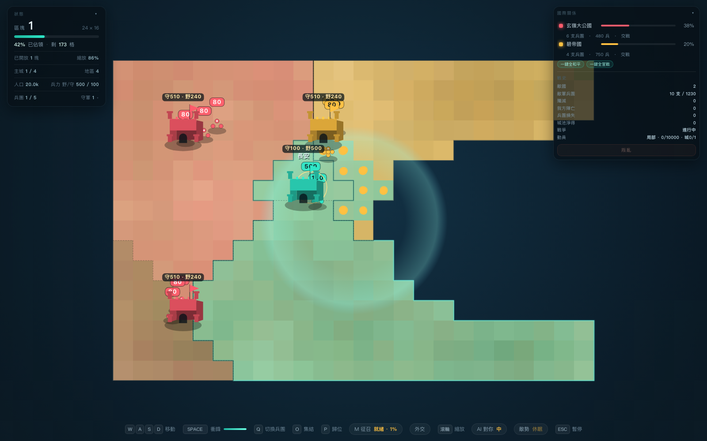

<div align="center">

# 無盡領土 · Endless Territory

**一個單檔 HTML 的即時戰略遊戲 · 43 個版本全開源**

[▶ 線上玩最新版](https://sgxdvx123321-svg.github.io/endless-territory/versions/territory-v44.html) · [🗂 版本畫廊](https://sgxdvx123321-svg.github.io/endless-territory/) · [MIT](LICENSE)

</div>

---

## 開場：整條開發線，直接扔給社區

這是一款**用 AI 造出來的 HTML 戰爭遊戲**。從一個 `.html` 檔案開始，一路迭代到 v44，中間沒有編譯、沒有框架、沒有 `npm install`，雙擊就能玩。

現在把整條迭代線（**v2 → v44，43 個可玩快照**）原封不動扔上社區：**隨便下載、隨便玩、隨便改、隨便拿去用**。
沒有授權陷阱、沒有「僅供學習」，你覺得哪裡難玩就改哪裡，改完歡迎發 PR 或自己開分支。

也希望有更多人一起發揮創意，讓這個遊戲變得更耐玩——多加一個兵種、換一套經濟、寫一種新的 AI、把地圖生成整個重做，都算。

同時**真心求各位大佬出手**：

- **整理代碼**。現在是 7000 行單檔，`<style>`、`<canvas>`、遊戲邏輯全塞在一起。歡迎幫我拆成正常的模組結構（`src/world.js`、`src/army.js`、`src/render.js`…），或是加上 TypeScript 型別。
- **做出 HTML 以外的版本**。桌面版（Electron / Tauri）、手機 App、Unity / Godot / PixiJS 重製，甚至是原生的獨立遊戲，都歡迎——素材與數值都在源碼裡，可以直接搬。
- **把這堆版本史整理成能維護的東西**。43 個快照現在只是並排躺著，如果你看得出哪條分支該留、哪段該砍，非常歡迎。

> 這個專案沒有任何商業目的，純粹是一個「AI + 一個人 + 兩天」能走到哪裡的實驗。玩得開心就好。



---

## 這是什麼遊戲

你操控的不是一個人，而是**一支兵團**——走過的格子就是你的領土。

- **佔地**：兵團走過的格立即歸你，敵方要踩過去才能搶回去。
- **攻城**：站在敵方主城旁幾秒即可佔下；該地區其他格子被吃光，主城自己也會投降（v32 起改為只加速攻城）。
- **兵團**：人口每 30 秒成長，每 1 萬人成軍。兵團打光了，就由下一支接管。
- **世界**：288×144 格、**63 個可征服區塊**、**306 座主城**、你 + 12 個 AI 政權（最大 50 城）。
- **外交**：和平 / 戰爭 / 同盟三態，AI 之間也會自己打、自己結盟、自己叛亂。
- **兩種開局**：`逐步開放`（一塊一塊往外打）或 `完整大陸`（開局整張地圖攤開，直接打大戰略）。

---

## 馬上玩

| 方式 | 連結 |
|---|---|
| ▶ **線上直接玩最新版 v44** | <https://sgxdvx123321-svg.github.io/endless-territory/versions/territory-v44.html> |
| 🗂 **版本畫廊（線上）** | <https://sgxdvx123321-svg.github.io/endless-territory/> |
| 原始檔 | [`versions/territory-v44.html`](versions/territory-v44.html) |
| 下載全部版本 | `git clone` 見下方 |

> 線上版用 GitHub Pages 部署，手機瀏覽器也能開；想離線玩就直接下載單檔。

下載全部版本：

```bash
git clone https://github.com/sgxdvx123321-svg/endless-territory.git
cd endless-territory
open versions/territory-v44.html   # macOS；Windows 直接雙擊
```

加了 `?seed=12345` 可以重現同一張世界；`?auto` 會跳過主選單直接開局（做截圖 / 測試用）。

---

## 操作

| 按鍵 | 功能 |
|---|---|
| `W` `A` `S` `D` | 移動兵團 |
| `Space` | 衝鋒（加速） |
| `Q` / `E` | 切換操控的兵團 |
| `+` / `-` | 補兵 / 縮放 |
| `O` | 集結令（最近 N 支 / 全國） |
| `P` | 歸位（回自家主城） |
| `M` | 緊急征召（人口 → 兵力） |
| `N` | 抽調守軍 |
| `F` | 視角對準當前兵團 |
| `1`–`4` | 統合兵團陣法 |
| `Esc` | 暫停 / 設定（難度、征召比例、存讀檔） |

滑鼠：左鍵點自己部隊即在該處接管；**右鍵**點擊整隊併入統合兵團、右鍵拖曳框選；滾輪縮放，左鍵拖曳平移視角。

---

## 版本一覽

九個時期，43 個可玩快照。完整演進說明見 [`docs/VERSIONS.md`](docs/VERSIONS.md)，逐版細節見 [`docs/CHANGELOG.md`](docs/CHANGELOG.md)。

<details open>
<summary><b>一 · 基礎期 v2 – v5</b>：地圖怎麼長出來</summary>

| 版本 | 關鍵改動 |
|---|---|
| v2 | 基準版。區塊制世界、吃光已開放區塊才開新塊、可縮放視角 |
| v3 | 地區 + 主城：站在城內 5 秒攻下，地區被吃光自動歸降 |
| v4 | 一整塊大陸、同心圈開圖 |
| v5 | 大陸遮罩 + 洪水填充，修掉「孤島卡死」的致命問題 |

</details>

<details>
<summary><b>二 · 玩法期 v6 – v9</b>：世界的質感與難度</summary>

| 版本 | 關鍵改動 |
|---|---|
| v6 | 地質（草原/雪原/沙漠/雨林）、人口成長、兵團、補給式戰役 |
| v7 | 兵團即棋子，移除英雄本體 |
| v8 | 守城優勢全面上線（傷害三檔、減傷、全民皆兵） |
| v9 | 圍城抽兵收緊；敵軍優勢延後到第 11 塊，並加 ESC 開關 |

</details>

<details>
<summary><b>三 · 指揮期 v10 – v13</b>：玩家看得到、叫得動</summary>

| 版本 | 關鍵改動 |
|---|---|
| v10 | 總兵力顯示、兵團清單、`O` 集結令 |
| v11 | `M` 緊急征召（1% 人口 → 兵力） |
| v12 | 征召比例可在 ESC 調（1–20%） |
| v13 | 集結可選「最近 N 支 / 全國」、`P` 歸位 |

</details>

<details>
<summary><b>四 · 帝國期 v14 – v17</b>：戰役規模化</summary>

| 版本 | 關鍵改動 |
|---|---|
| v14 | 兵團軟推擠、第二片大陸、外交、3 個存檔槽 |
| v15 | 推擠改「移動阻擋」、BFS 尋路、據點經濟、城池命名、自動存檔 |
| v16 | 兵團上限自動化（`max(5, 城池數)`） |
| v17 | `N` 真正均攤、敵國結盟（只打玩家） |

</details>

<details>
<summary><b>五 · AI 期 v18 – v20</b>：兵團怎麼想、戰爭怎麼記</summary>

| 版本 | 關鍵改動 |
|---|---|
| v18 | 目標分配（每秒重算、每目標最多 3 支）、三層優先、局部先打 |
| v19 | 戰史面板（殲滅/陣亡/兵團損失/城池淨得） |
| v20 | 叛亂：切出連通地區獨立成新政權，可選邊 |

</details>

<details>
<summary><b>六 · 大陸期 v21 – v25</b>：一個世界，很多國家</summary>

| 版本 | 關鍵改動 |
|---|---|
| v21 | 移除第二大陸、63 區塊、開局模式、12 政權、16 種顏色 |
| v22 | 修好單國頁面、兵團就近原則 |
| v23 | 完整大陸開局全和平、一鍵全和平 / 全宣戰 |
| v24 | 野戰軍 vs 守備軍數值區分 |
| v25 | 敵方成長改成按玩家兵力換算 |

</details>

<details>
<summary><b>七 · 兵制期 v26 – v33</b>：單位、隊形、規則收斂</summary>

| 版本 | 關鍵改動 |
|---|---|
| v26 | 守軍進城變數字、攻城野戰軍生在城外 |
| v27 | 統合兵團 v1（四種陣法） |
| v28 | 多個統合兵團、隊內穿透 |
| v29 | 修 ESC「兵團數量顯示」選不動 |
| v30 | 人數集中顯示在主將頭上、存檔槽 3 → 10 |
| v31 | 掉隊 3 秒歸隊、集結令排除同隊 |
| v32 | 佔光地區不再歸降、敵軍三軍團制、分兵 |
| v33 | 敵軍守軍每 30 秒 10% 轉野戰軍 |

</details>

<details>
<summary><b>八 · 收斂期 v34 – v38</b>：操作、規則、戰史收尾</summary>

| 版本 | 關鍵改動 |
|---|---|
| v34 | 拖曳編隊、敵方人口轉守軍、敵軍攻擊性上調 |
| v35 | 三無城池 3 秒可佔、15 秒沒人佔自動補兵 |
| v36 | 統合兵團攻擊優先、被圍攻中的城不能徵兵 |
| v37 | 統合兵團編隊改用右鍵，左鍵留給點選與改名 |
| v38 | 區塊模式也開放外交、已消亡勢力列表 |

</details>

<details>
<summary><b>九 · 磨合期 v39 – v44</b>：兵團、守備軍、卡死收尾</summary>

| 版本 | 關鍵改動 |
|---|---|
| v39 | 兵團合併（每國 250 上限）、方向鎖修掉兵團抽搐 |
| v40 | 出城的守備軍打完仗自己走回城 |
| v41 | 守備軍可編入統合兵團、人數標籤分「守／野」、整隊跟緊主帥 |
| v42 | 軍團不再橫衝直撞、主城圍困 30 秒判定、中英雙語 |
| v43 | 野戰軍回城變數字、定期定位回收、敵方沒戰爭不派兵 |
| v44 | 部隊不再互相卡死（側移／穿友軍／撤收）、集結令環形站位、主城標記多一欄「儲」 |

</details>

---

## 專案結構

```
endless-territory/
├─ index.html                版本畫廊（可當 GitHub Pages 首頁）
├─ versions/                 43 個單檔快照 territory-v2 … v44.html
├─ docs/
│  ├─ VERSIONS.md            九個時期的演進線（推薦先讀這個）
│  └─ CHANGELOG.md           逐版詳細記錄，含驗證數據
├─ screenshots/              遊戲截圖
└─ LICENSE
```

---

## 想改代碼？從這裡下手

每個 `.html` 都是一個完整可跑的遊戲，結構固定：

```
<style>  … CSS / HUD 樣式
<canvas> … 只有一張畫布
<script> … 世界生成 → 實體 → update(dt) → render() → 輸入 / UI
```

v44 裡最值得先看的幾個位置：

| 位置 | 內容 |
|---|---|
| `buildWorld()` / `buildBiomes()` | 大陸遮罩、湖泊、區塊切分、可達性洪水填充 |
| `openZone()` / `openNextZone()` | 區塊開放、地形繪製、接縫處理 |
| `update(dt)` | 主迴圈：AI、兵團、圍城、人口、外交全部在這裡排隊 |
| `render()` | 全部繪製（地形快取 + 部隊 + 特效） |
| `updateSiege(dt)` | 攻城 / 歸降 / 守軍轉換 |
| `buildPath()` / `stepTo()` | BFS 尋路與逐格推進 |
| `startGame()` / `saveToSlot()` / `loadFromSlot()` | 開局與存檔（localStorage，存檔格式有版本號） |

**已知的坑**（歡迎修）：單檔裡全域變數極多（`G`、`CFG`、`b`、`t`）、UI 用字串拼 `innerHTML`、沒有測試、沒有事件解綁、部分數值寫死在函數中間。

### 我特別希望有人做的事

1. **拆檔**：把 7000 行拆成 ESM 模組，順手加 `vite` 或乾脆零依賴打包。
2. **型別**：`CFG` 與 `G` 加 TypeScript 介面，先從型別標註開始就好。
3. **抽離渲染**：`render()` 現在直接畫 canvas，換 PixiJS / WebGL 會快很多（650 支部隊時幀時間 9–14ms）。
4. **AI 重寫**：現在的 AI 是規則式（目標分配 + 三層優先 + 局部動員），換成行為樹或影響力地圖（influence map）應該會更像人。
5. **移植**：Godot / Unity / 純 JS 引擎版本，數值表都在 `CFG` 裡。
6. **平衡**：每一版的參數都能在 `CFG` 找到，歡迎直接改數字發 PR。

---

## 授權

[MIT](LICENSE) — 商用、修改、再發布都可以，保留版權聲明即可。
（如果你要用到自己的專案裡，連引用都不用寫，玩得開心比較重要。）

## 致謝

整個專案由 **AI 生成 + 人工調參** 完成：世界生成、AI、UI、平衡數值，以及 43 次「這版太強 / 這版會卡死」的重寫。
如果你把它改得更好玩了，歡迎開 PR 或 issue，讓我也玩一下。
